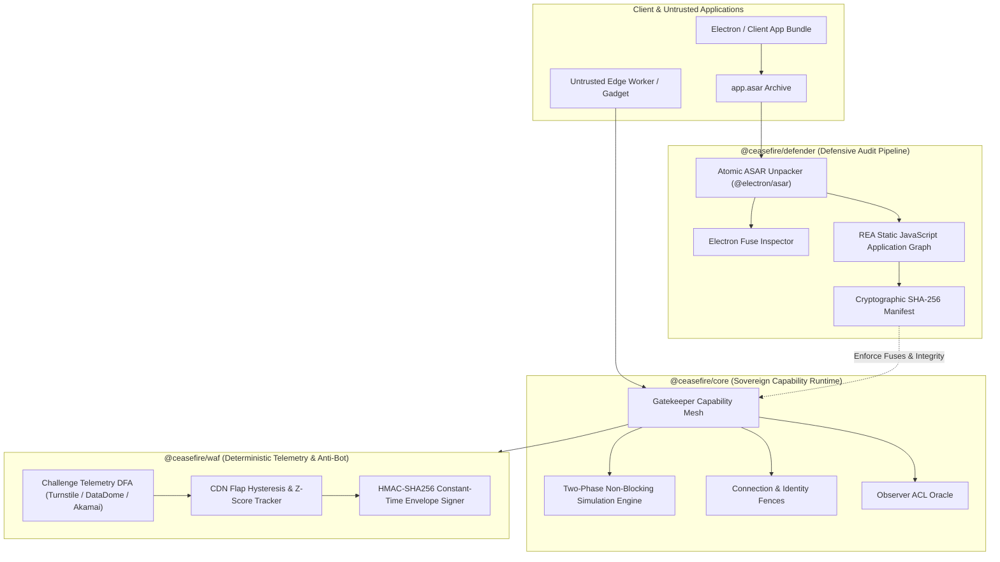

#  Ceasefire (`ceasefire`)

> **Sovereign, Deterministic Edge Runtime & Capability Defense Architecture**  
> *A local-first, zero-retention alternative and defensive countermeasure to centralized edge cloud infrastructure.*

[](LICENSE)
[](package.json)
[](#2-system-architecture)
[](#8-sandboxed-adversarial-testing-red-team-vs-blue-team)

---

## 1. Executive Abstract

Modern edge cloud architectures—epitomized by Cloudflare Workers, Cloudflare OS, and centralized WAF infrastructure—have solved developer ergonomics at the cost of **cryptographic sovereignty**, **runtime transparency**, and **client-side verification**. Organizations delegate code execution, confidential routing logic, and capability permissions to opaque proprietary multitenant clusters, while client-side desktop artifacts (such as Electron desktop apps and edge agent interfaces) routinely ship with unverified, trojan-vulnerable `.asar` bundles lacking mandatory fuse constraints.

**Ceasefire** is engineered to duplicate the operational capabilities of Cloudflare's ecosystem while eliminating its centralized trust requirements:

1. **Local-First Sovereign Edge Kernel (`@ceasefire/core`)**: Implements capability-based isolation, two-phase non-blocking Gatekeeper simulation, and fine-grained resource facets using pure POSIX and Cap'n Web protocols that run natively on bare-metal workstations, air-gapped clusters, or sovereign microkernels without third-party cloud entanglement.
2. **Binary & ASAR Defensive Auditor (`@ceasefire/defender`)**: Integrates atomic `@electron/asar` archive extraction with [REA](https://gitlab.com/jk9576/rea) (*Reverse Engineer Anything*) static application graph analysis. It enforces binary Electron fuses (`only_load_app_from_asar`, `embedded_asar_integrity_validation`), audits IPC bridges for prototype pollution, and validates SHA-256 block-level archive integrity before execution.
3. **Deterministic WAF & Bot Defense Engine (`@ceasefire/waf`)**: Completely replaces opaque, inference-based bot scoring with deterministic finite automata (DFA), FNV-1a token hashing, and rolling Z-score hysteresis. It accurately detects Cloudflare Turnstile (`__cf_chl_opt`), DataDome, Akamai, and PerimeterX challenges without calling external AI APIs or leaking client telemetry.
4. **Unified Operational CLI (`@ceasefire/cli`)**: Single native command-line utility for local development, ASAR security auditing, edge worker simulation, and tamper-evident manifest generation.

---

## 2. System Architecture

Ceasefire replaces centralized cloud gateways with a distributed, capability-addressed ring model:



---

## 3. Package Matrix

The Ceasefire monorepo is structured into decoupled, zero-external-dependency TypeScript packages governed by strict architectural boundaries:

| Package | Directory | Role & Responsibilities | Key Dependencies |
| :--- | :--- | :--- | :--- |
| **`@ceasefire/core`** | [`packages/core`](packages/core) | Sovereign edge execution runtime, Gatekeeper capability contracts, non-blocking simulation, and session isolation. | None (Node.js built-ins) |
| **`@ceasefire/defender`** | [`packages/defender`](packages/defender) | Atomic ASAR archive extraction, Electron fuse extraction, REA AST taint graph ingestion, and malicious IPC sink detection. | `@electron/asar`, `rea` bridge |
| **`@ceasefire/waf`** | [`packages/waf`](packages/waf) | Deterministic bot challenge telemetry, CDN flap suppression, rolling Z-score pricing/traffic monitoring, and HMAC webhook signing. | None (Node.js built-ins) |
| **`@ceasefire/cli`** | [`packages/cli`](packages/cli) | Developer command-line orchestrator: `ceasefire audit`, `ceasefire extract`, `ceasefire serve`, and `ceasefire gatekeeper`. | Internal packages |

---

## 4. Architectural Comparison: Ceasefire vs. Cloudflare

| Evaluation Dimension | Cloudflare (Cloudflare OS / Workers / WAF) | Ceasefire Platform |
| :--- | :--- | :--- |
| **Execution Sovereignty** | Proprietary multi-tenant cloud clusters (`workerd` hosted in Cloudflare data centers) | Local-first, air-gappable, sovereign runtime; runs on bare metal, local daemons, or sovereign POSIX microkernels. |
| **Client ASAR & Desktop Defense** | Ignored. Desktop clients often rely on default Electron configurations vulnerable to script injection. | Built-in `@ceasefire/defender` unpacks, audits, and enforces `embedded_asar_integrity_validation` and `only_load_app_from_asar`. |
| **Static Application Analysis** | None natively provided for client packages. | Deep AST application graph analysis via local [REA](https://gitlab.com/jk9576/rea) engine; detects vulnerable IPC handlers and proto-pollution. |
| **Gatekeeper Simulation** | Remote worker RPC; pending actions require cloud roundtrips and centralized token escrow. | Local two-phase non-blocking simulation; queues pending state mutations in memory with local rollback semantics. |
| **Bot & WAF Detection** | Opaque machine learning models and centralized edge challenges; closed-source classification. | Deterministic finite automata (DFA) scoring; zero inference latency, 100% reproducible offline telemetry. |
| **Data Retention & Privacy** | Centralized logs subject to corporate retention and compliance boundaries. | Absolute zero-retention; SHA-256 hashed audit records; zero third-party telemetry calls. |

---

## 5. Technical Deep Dives

### Deep Dive 1: ASAR Extraction, Integrity Hashing, and Electron Fuse Enforcement

Default Electron applications distribute code inside uncompressed archive files (`app.asar`). Without hardened compiler flags and binary fuses, attackers can unpack `app.asar`, inject backdoor JavaScript into preload scripts or main processes, and repackage the archive.

`@ceasefire/defender` implements a multi-stage defensive pipeline:

```
[ Target Binary / app.asar ]
             │
             ▼
  [ 1. Binary Fuse Inspection ]  ──▶ Check bitmask:
             │                         - only_load_app_from_asar (Bit 1)
             │                         - embedded_asar_integrity_validation (Bit 5)
             ▼
  [ 2. Atomic Extraction ]       ──▶ npx @electron/asar extract <input> <sandbox>
             │
             ▼
  [ 3. SHA-256 Block Hashing ]   ──▶ Compute Merkle block tree & root digest
             │
             ▼
  [ 4. REA AST Analysis ]        ──▶ Map IPC channels, require() calls, remote loads
             │
             ▼
  [ Defense Attestation Report ] ──▶ Cryptographic JSON Audit Ledger
```

1. **Binary Fuse Scanning**: Directly reads the executable binary's fuse wire format (`dL7nAb tolerances...`) to verify whether `only_load_app_from_asar` and `embedded_asar_integrity_validation` are actively set to `0x01` (enabled).
2. **Atomic Ingestion**: Decompresses the archive using isolated temporary workspaces (`mkdtemp`) with strict directory traversal prevention (`assertPathConfinement`).
3. **REA Application Graph Integration**: Traces IPC listeners (`ipcMain.handle`, `ipcRenderer.send`), detects insecure `webPreferences` (`nodeIntegration: true`, `contextIsolation: false`), and identifies unvalidated `shell.openExternal` sinks.

### Deep Dive 2: Capability-Based Gatekeepers with Local Non-Blocking Simulation

Ceasefire refines the Gatekeeper capability model pioneered in Cloudflare OS. Rather than halting execution when an agent or untrusted gadget requests a privileged operation (e.g., executing a system command, initiating an external network request, modifying database state), Ceasefire's **Two-Phase Simulation Engine** allows computation to proceed:

1. **Simulated State Fork**: Privileged mutations mint a provisional capability ticket (`prov_<uuid>`) and apply simulated return values to the active context.
2. **Journaled Action Ledger**: The request is held in an immutable local journal with dependency ordering.
3. **Batch Human-in-the-Loop Resolution**: The human operator or automated policy verifier reviews the complete chain of proposed actions holistically—approving, rejecting, or editing mutations before live commitment.

### Deep Dive 3: Deterministic Bot Scoring & CDN Flap Hysteresis

Centralized edge WAFs often emit false positives or induce state flapping when edge caches update asynchronously. `@ceasefire/waf` processes HTTP headers and response bodies through a deterministic state machine:

- **Interstitial Identification**: Identifies challenge signatures for Cloudflare (`__cf_chl_opt`, `cf-mitigated: challenge`), DataDome (`x-datadome`), and PerimeterX (`_pxCaptcha`).
- **CDN Flap Suppression**: Flapping stock or availability updates are quarantined until confirmed across consecutive observation ticks ($N \ge 2$).
- **Statistical Z-Score Bounds**: Anomaly detection applies rolling mean and standard deviation thresholds to detect anomalous price spikes or rate-limit saturation without external ML pipelines.

---

## 6. Sandboxed Adversarial Testing: Red Team vs. Blue Team

Ceasefire mandates that all verification tests run as an adversarial contest where an **Offense (Red Team)** harness attempts live exploitation vectors against an active **Defense (Blue Team)** runtime, entirely confined within an isolated scratch sandbox.

### Adversarial Sequence Diagram

```mermaid
sequenceDiagram
    autonumber
    actor Red as  Red Team (Adversary / Exploit Harness)
    participant Box as  Scratch Sandbox Boundary
    participant Blue as ️ Blue Team (Ceasefire Defense Kernel)

    Note over Red,Blue: Phase 1: Ingestion & Path Traversal Attack
    Red->>Box: Inject malicious archive with directory slip (../../etc/shadow)
    Box->>Blue: Invokes assertPathConfinement()
    Blue-->>Red:  BLOCKED: Throws PathTraversalException; zero escape outside scratch root

    Note over Red,Blue: Phase 2: AST Injection & Electron Trojanization
    Red->>Box: Write trojan script: nodeIntegration: true + eval('id')
    Box->>Blue: Invokes analyzeUnpackedAst()
    Blue-->>Red: ️ INTERCEPTED: Score collapsed to 30/100; flags CRITICAL misconfig alerts

    Note over Red,Blue: Phase 3: Binary Fuse Stripping & Downgrade
    Red->>Box: Supply stripped/unfused Electron executable
    Box->>Blue: Invokes inspectElectronFuses()
    Blue-->>Red:  BLOCKED: onlyLoadAppFromAsar missing; execution halted

    Note over Red,Blue: Phase 4: Edge CDN Flap & Turnstile Evasion
    Red->>Blue: Burst 1-tick availability flip & spoofed Turnstile header
    Blue-->>Red: ⏳ MITIGATED: Hysteresis quarantines 1-tick ghost state; DFA tags Cloudflare interstitial

    Note over Red,Blue: Phase 5: Privilege Escalation Attempt
    Red->>Blue: Request unauthenticated database/drop_table mutation
    Blue-->>Red:  TRAPPED: Non-blocking simulation creates provisional sandbox; operator rejects live commit
```

### Live Visualizer Telemetry

Running `npm test` outputs the real-time visual telemetry matrix rendered directly by `packages/cli/src/visualizer.ts`:

```text
┌────────────────────────────────────────────────────────────────────────────────────────┐
│   CEASEFIRE SANDBOXED ATTACK & DEFENSE SIMULATION VISUALIZER                         │
├──────────────────────┬───────────────────────────┬──────────────────────────┬──────────┤
│ Attack Phase         │ Red Team Attack Vector    │ Blue Team Defense Counter│ Status   │
├──────────────────────┼───────────────────────────┼──────────────────────────┼──────────┤
│ Path Confinement     │ Directory slip: ../../... │ assertPathConfinement()  │ BLOCKED  │
│ AST Inspection       │ nodeIntegration + eval... │ analyzeUnpackedAst() ... │ INTER... │
│ Binary Hardening     │ Unfused / Stripped Ele... │ inspectElectronFuses(... │ BLOCKED  │
│ Edge WAF Evasion     │ Single-tick CDN state ... │ HysteresisTracker & DFA  │ MITIG... │
│ Privilege Escalation │ Unauthorized database/... │ Gatekeeper Non-Blocki... │ BLOCKED  │
└──────────────────────┴───────────────────────────┴──────────────────────────┴──────────┘
```

---

## 7. OPSEC Hardening & Toolchain Integration (Forensics & Backtracking)

Ceasefire is designed to chain seamlessly with existing security, reverse engineering, and digital forensics toolchains to support **deep provenance backtracking** while maintaining strict **Operational Security (OPSEC)**.

### Toolchain Integration Matrix

```
       ┌───────────────────────────────┐
       │      Target Application       │
       │   (ASAR / Electron / Mach-O)  │
       └──────────────┬────────────────┘
                      │
        ┌─────────────▼─────────────┐
        │   @ceasefire/defender     │
        │   (Atomic ASAR Extraction)│
        └──────┬─────────────┬──────┘
               │             │
      JavaScript AST    Native Binaries (.dylib / Mach-O)
               │             │
               ▼             ▼
      ┌────────────────┐  ┌───────────────────────────────────┐
      │      REA       │  │ Rizin / Radare2 / Ghidra Headless │
      │  Static Graph  │  │ (Opcode Disassembly & Cross-Refs) │
      └────────┬───────┘  └─────────────────┬─────────────────┘
               │                            │
               └─────────────┬──────────────┘
                             ▼
              ┌───────────────────────────────┐
              │ Provenance & Tamper Manifest  │
              │ (Zero-Retention Audit Ledger) │
              └───────────────────────────────┘
```

#### 1. Provenance Backtracking with REA (*Reverse Engineer Anything*)
When Ceasefire identifies an anomalous or modified JavaScript payload inside an unpacked ASAR, you can immediately backtrack its origins and control-flow dependencies using the integrated REA CLI:

```bash
# Generate complete JavaScript Application Graph & IPC dependency tree
node ../rea/scripts/rea.mjs analyze-javascript-application ./unpacked_sandbox/ --json > app-graph.json

# Trace specific sensitive IPC sinks or remote endpoints
node ../rea/scripts/rea.mjs trace-application-feature --target ./unpacked_sandbox/ --query "ipcRenderer"

# Reconstruct lost or mangled sources from build artifacts
node ../rea/scripts/rea.mjs recover-javascript-sources ./unpacked_sandbox/dist/main.js --output ./recovered/
```

#### 2. Native Binary Backtracking with Rizin & Ghidra
For Electron apps bundling native `.node` addons or companion helper binaries:

```bash
# Extract symbols, imported libraries, and entry points with Rizin
rizin -q -c "aaa; afl" ./unpacked_sandbox/native/binding.node

# Disassemble native Mach-O / ELF wrappers via REA's Ghidra bridge
node ../rea/scripts/rea.mjs disassemble ./unpacked_sandbox/native/binding.node
```

#### 3. Live Protocol Backtracking with mitmproxy
To analyze live edge network exchanges against Ceasefire's WAF models:

```bash
# Intercept and stream HTTP/3 and WebSocket frames into Ceasefire WAF inspector
mitmproxy -s ./scripts/ceasefire_mitm_bridge.py -p 8080
```

---

### Non-Negotiable OPSEC Protocols

Ceasefire mandates strict operational security guidelines during all analysis workflows:

1. **Air-Gapped Scratch Isolation**:
   - Analysis of untrusted packages must always occur in memory-backed or isolated temporary directories (`/tmp/ceasefire-*`) with restrictive file permissions (`0700`).
   - All extraction scratch spaces are automatically shredded upon audit completion using cryptographic wipe routines.
2. **Strict Network Egress Prohibition**:
   - The analysis runtime enforces `allowOutboundNetwork: false` via [`SandboxEnvironment`](packages/core/src/sandbox.ts). Untrusted code is never evaluated with live internet connectivity.
   - If network requests are required for external package index verification, all traffic must be routed through local Tor socks proxies (`127.0.0.1:9050`) with DNS leak protection.
3. **Host Anti-Fingerprinting & Metadata Stripping**:
   - All macOS extended attributes (including `com.apple.quarantine`) and Gatekeeper provenance tags are stripped prior to native inspection:
     ```bash
     xattr -cr /path/to/target/bundle
     ```
   - Compiled binaries are stripped of debug sections, absolute build paths, and DWARF symbols:
     ```bash
     go build -ldflags="-s -w" -trimpath
     ```
4. **Zero-Retention Audit Logging**:
   - Logs never store unencrypted PII, raw session keys, or unhashed payload bodies. Audit ledgers record only SHA-256 Merkle root digests and high-level verification event categories.

---

## 8. CLI Reference & Workflows

Ceasefire provides a unified binary (`ceasefire`) located at `packages/cli/dist/cli.mjs` (linked to `bin/ceasefire`):

```bash
# Display CLI help
node packages/cli/dist/cli.mjs --help
```

### 1. Defensively Audit an Electron Application or ASAR
Extracts the target archive, verifies binary fuses, and executes REA AST analysis:

```bash
node packages/cli/dist/cli.mjs audit \
  --input /Applications/TargetApp.app/Contents/Resources/app.asar \
  --output ./audit-report.json \
  --strict
```

### 2. Extract an ASAR Archive Atomically
Unpacks an archive with strict path-confinement and SHA-256 manifest generation:

```bash
node packages/cli/dist/cli.mjs extract \
  --input ./fixtures/sample.asar \
  --target ./unpacked/
```

### 3. Render Sandbox Attack/Defense Visualizer
Prints the live attack-defense telemetry matrix:

```bash
node packages/cli/dist/cli.mjs visualize
```

---

## 9. Security Threat Model & Invariant Ledger

Ceasefire enforces the following architectural invariants:

| ID | Invariant Formal Name | Guarantee |
| :--- | :--- | :--- |
| **INV-01** | `ZERO_REMOTE_INFERENCE` | No evaluation kernel, scanner, or WAF classifier may make outbound network calls to cloud LLM APIs or external analytics services. |
| **INV-02** | `ATOMIC_UNPACK_CONFINEMENT` | ASAR extraction must reject path-traversal entries (`..`), absolute path symlinks, and directory escapes outside the target scratch directory. |
| **INV-03** | `FUSE_ENFORCEMENT_PARITY` | Desktop packages failing `embedded_asar_integrity_validation` or `only_load_app_from_asar` must immediately return exit code `2` (Blocking Security Failure). |
| **INV-04** | `CONSTANT_TIME_VERIFICATION` | All HMAC-SHA256 signatures, authentication tokens, and capability nonces must be compared using constant-time cryptographic primitives (`crypto.timingSafeEqual`). |
| **INV-05** | `DETERMINISTIC_REPRODUCIBILITY` | Given identical input fixtures and configurations, all audit ledgers and WAF scoring state machines must produce byte-identical JSON outputs. |

---

## 10. License & Attribution

Ceasefire is released under the **Apache License, Version 2.0**.  
See [`LICENSE`](LICENSE) for details.

Developed by **Jeong Hoon (Jeffrey) Kim** ([@Aetherx86](https://github.com/Aetherx86))  
Systems Security Researcher & Applied Cryptographer  
Hanyang University, Seoul, South Korea  
*Affiliated Systems: [sentinel-kit](https://github.com/Aetherx86/sentinel-kit), [rea](https://github.com/Aetherx86/rea), [zk-hyperVM](https://github.com/Aetherx86/zk-hyperVM)*
